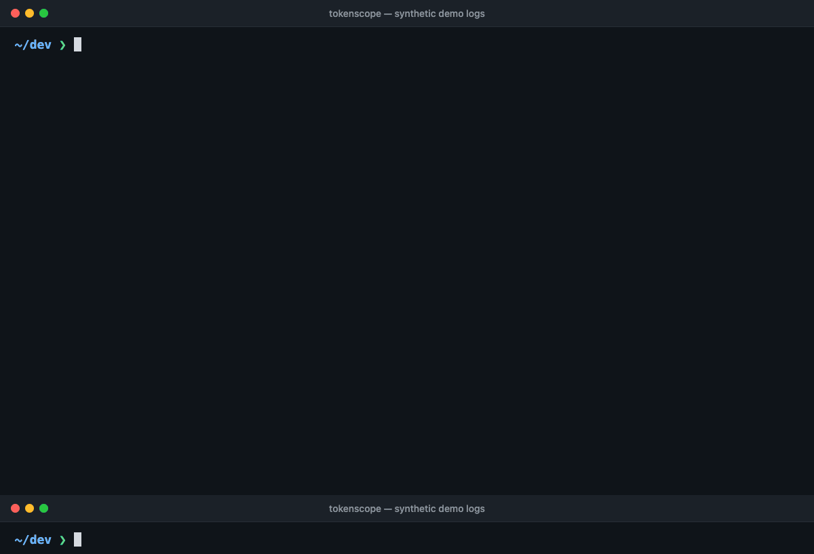

<div align="center">

# tokenscope

**Your AI coding agent wasted money last month. tokenscope shows exactly where.**

*ccusage tells you what you spent. tokenscope tells you what you wasted.*

`npx @mintwork/tokenscope`

Zero dependencies · runs 100% locally · Claude Code, Codex, Gemini CLI, OpenCode, Cline, Roo, Copilot CLI and more · MIT

[](https://github.com/mintwork/tokenscope/actions/workflows/ci.yml) [](https://www.npmjs.com/package/@mintwork/tokenscope) [](https://www.npmjs.com/package/@mintwork/tokenscope#provenance) [](package.json) [](LICENSE) [](package.json) [](https://github.com/mintwork/tokenscope/stargazers)



<sub>Recorded from the real CLI on synthetic logs (`npm run demo:gif`).</sub>

</div>

---

You know the bill. You don't know which part was **wasted**:

- your prompt cache expiring every time you spend 10 minutes reading the agent's answer, so a 500k-token context is re-written at cache-*write* price instead of read at cache-*read* price
- the agent running `npm test` five times in a row and getting the same failure back every time
- the same 2,000-line file read 40 times without anyone editing it
- a 60k-token log `cat`-ed into context, then paid for again on every later request

tokenscope reads the session logs your agents already keep on disk, finds these patterns, estimates what each one cost, and tells you how to stop it. Then it shows the full spend as a flame graph, so you can see the rest too.

## Install

```bash
npx @mintwork/tokenscope               # waste first, then spend, in the terminal
npx @mintwork/tokenscope --html --open # interactive report with the flame graph
```

Needs Node 22+ (22.13+ to read OpenCode's SQLite database). No configuration, no API keys, no network calls. Your logs never leave your machine.

## What it finds

Every finding comes with an estimated dollar cost and a one-line fix.

| Pattern | What it means | Fix it suggests | Counted in headline? |
|---|---|---|---|
| **Cache rebuilds while you read/reply** | A gap of 5-60 min after the agent's answer (you were reading or thinking) outlived the 5-minute cache TTL, so the whole context was re-written. | Turn on the 1-hour cache TTL (Claude Code: `"promptCacheTtl": "1h"` in `~/.claude/settings.json`). Only suggested when it nets a saving. **Never** `/clear`, which would lose the context and cost about the same to rebuild. | ✅ net saving of the 1h TTL |
| **Cache rebuilds while the agent waited on a tool** | A tool call (or your approval) took 5-60 min and the cache expired. tokenscope names the tool and command, e.g. `Bash(npm run build) 12 min`. | Run long commands in the background (Claude Code: `run_in_background`, `/tasks`), or use the 1-hour TTL. | ✅ net saving of the 1h TTL |
| **Loops** | The same tool called with the same input **and the same result**, several times in a row. | Interrupt early. Add a rule to `CLAUDE.md` / `AGENTS.md`: "if a command fails the same way twice, stop and ask". | ✅ |
| **Repeated calls** | Identical call, identical answer, scattered through a session. | Tell the agent to reuse earlier results, or note slow-changing facts in the instructions file. | ✅ |
| **Unchanged re-reads** | The same file (same range) read again with no edit in between. | Put the key facts in `CLAUDE.md` / `AGENTS.md`, or read a line range. | ✅ |
| **Mid-session prompt changes / model switches** | The cache was rebuilt with no idle gap: instructions or tools changed, compaction ran, or the model switched. | Don't edit instructions or toggle MCP servers mid-session; stick to one model. | ➖ shown separately as *likely avoidable* |
| **Huge tool outputs** | A single tool result above 10k tokens (configurable), carried by every later request. | `head`, `grep`, `--limit`; "never cat logs or lockfiles". | ➖ shown separately as *likely avoidable* |
| **Rebuilds after breaks over an hour** | No cache lives that long. | None needed. A fresh session helps only if you're starting an unrelated task. | ❌ not waste, shown for context |

**Plus the spend side:** cost per session, project, model, day and tool, cache hit rate, how much caching saved you, and a **flame graph** (project → session → turn → API call → subagent) you can click to zoom.

### The HTML report

`npx @mintwork/tokenscope --html --open` writes one self-contained file: waste by pattern with fixes, which checks ran per agent, and a zoomable flame graph of spend.


<sub>Screenshot generated from synthetic logs (`npm run demo:png`). Open the <a href="https://mintwork.github.io/tokenscope/demo-report.html">interactive demo report</a>.</sub>

## How waste is estimated

Every number is a **counterfactual**: what the same work would have cost if one specific thing had been done differently, priced with the same table as your spend. tokenscope never counts the full cost of a request as waste; it counts only the difference.

- **Cache rebuilds (5-60 min gaps):** the counterfactual is *this whole session on a 1-hour cache TTL*. In that world:
  - each rebuild after a 5-60 min gap becomes a cache read of the context it carried over (new content is still written);
  - but **every** cache write in the session pays the 1h price (2× base input instead of 1.25×).

  The finding is `actual cache cost − counterfactual cache cost`, computed per session (each subagent separately). If the premium outweighs the savings, there is no finding and no recommendation. The terminal also shows what the setting would net if you turned it on for *every* session, including those that would only pay the premium.
- **Gaps over an hour** are beyond any TTL. They're listed as unavoidable and never added to waste.
- **Rebuilds with no gap** (prompt prefix changed, model switched): the tokens carried over from the previous request × (write price − read price). These are only *likely* avoidable, because compaction or a deliberate model switch may have been worth it, so they're kept out of the headline.
- **Loops:** the cost of the repeated round trips after the first (their share of each request).
- **Repeats, unchanged re-reads, huge outputs:** the avoidable tokens (output size ÷ 4) × the price of adding them to the context once, plus the cache reads every later request in that context paid to carry them. Re-reads only count when the file wasn't edited in between and the same range was read.

The headline (**"could have been saved"**) is the sum of the ✅ rows only. The likely-avoidable amount is shown next to it, never added in. Each detector only runs on agents whose logs contain the data it needs; anything else is reported as *not checked*, never as $0.

## tokenscope vs ccusage

[ccusage](https://github.com/ccusage/ccusage) is great, and you should probably keep using it. The two tools answer different questions:

| | ccusage | tokenscope |
|---|---|---|
| Question it answers | *How much did I spend?* | *What did I waste, and how do I stop?* |
| Daily / monthly / session spend | ✅ excellent | ✅ |
| Agents supported | ~19 | 12 (see below) |
| Live status line, billing blocks | ✅ | ❌ |
| Waste detection (cache rebuilds, loops, re-reads, giant outputs) | ❌ | ✅ with counterfactual $ estimates and fixes |
| Why a cache miss happened (you paused / long tool / prefix change / model switch) | ❌ | ✅ |
| Flame graph down to individual tool calls | ❌ | ✅ |
| Subagent cost attributed to the call that spawned it | ❌ | ✅ |
| Says which checks it could run per agent | n/a | ✅ never reports $0 waste for missing data |

Use ccusage to track the bill. Run tokenscope when the bill surprises you.

## Supported agents

Each parser declares what its log format contains. A waste check only runs when the data it needs is there, and the report lists, per agent, which checks ran and what the logs were missing.

| Agent | Status | Cache rebuilds | Loops / repeats | Re-reads | Huge outputs | Default location |
|---|---|---|---|---|---|---|
| Claude Code | ✅ **verified on real logs** | ✅ | ✅ | ✅ | ✅ | `~/.claude/projects` |
| Codex CLI | 🧪 experimental (format from docs/source) | ✅ | ✅ | ◐ shell reads only | ✅ | `~/.codex/sessions`, `archived_sessions` |
| Gemini CLI | 🧪 experimental | ✅ | ✅ | ✅ | ✅ | `~/.gemini/tmp/*/chats` |
| Qwen Code | 🧪 experimental | ✅ | ✅ | ✅ | ✅ | `~/.qwen/projects` |
| OpenCode | 🧪 experimental | ✅ | ✅ | ✅ | ✅ | `~/.local/share/opencode` (SQLite needs Node 22.13+) |
| Kilo CLI | 🧪 experimental | ✅ | ✅ | ✅ | ✅ | `~/.local/share/kilo` |
| Cline | 🧪 experimental | ✅ | ✅ | ✅ | ✅ | VS Code globalStorage, `~/.cline/data` |
| Roo Code | 🧪 experimental | ✅ | ✅ | ✅ | ✅ | VS Code globalStorage |
| Kilo Code (extension, ≤ v5) | 🧪 experimental | ✅ | ✅ | ✅ | ✅ | VS Code globalStorage |
| GitHub Copilot CLI | 🧪 experimental | ❌ no per-request tokens on disk | ✅ | ✅ | ✅ | `~/.copilot/session-state` |
| Factory Droid | 🧪 experimental | ❌ session totals only | ◐ if transcript has tool blocks | ◐ | ◐ | `~/.factory/sessions` |
| Amp | 🧪 experimental | ✅ | ◐ tool-block shape unverified | ◐ | ◐ | `~/.local/share/amp/threads` |

*Experimental* means the parser was built from the agent's source code and docs, cross-checked against other open-source parsers, and tested on synthetic fixtures, but nobody has run it on a real user's logs yet. **If you use one of these agents, please run `npx @mintwork/tokenscope --source <agent>` and [open an issue](.github/ISSUE_TEMPLATE/sample-logs.yml) with a sanitized sample** if the numbers look off. That's how a parser becomes *verified*.

VS Code-family locations are checked for Code, Code - Insiders, Cursor, Windsurf, VSCodium, Positron, Antigravity, Trae and Kiro on macOS, Linux (including `~/.vscode-server`) and Windows. Run `npx @mintwork/tokenscope --list-sources` to see what was found where.

## Usage

```text
tokenscope [options]
tokenscope watch [options]   live alerts for the active Claude Code session (see below)

Output
  (default)              terminal summary: waste first, then spend
  --html [file]          self-contained HTML report (default: tokenscope-report.html)
  --json [file]          machine-readable report (stdout when no file given)
  --open                 open the HTML report when done

Filters
  --since <when>         7d, 24h, 2w, or a date (2026-11-01)
  --until <when>         same formats
  -p, --project <text>   only projects whose name/path contains <text>
  --source <ids>         comma-separated agent ids, or "all" (default: every agent found)

Sources
  --path <id>=<dir>      read agent <id> from <dir> (repeatable)
  --dir <dir>            shorthand for --path claude-code=<dir>
  --codex-dir <dir>      shorthand for --path codex=<dir>
  --list-sources         show every supported agent, where it looks, and what it found

Tuning
  --pricing <file>       JSON overrides merged over the built-in pricing table
  --huge <tokens>        tool output size flagged as huge (default 10000)
  --top <n>              rows per terminal section (default 8)
  --redact               hide prompts, titles, paths and commands
  --no-color             disable ANSI colors (also honors NO_COLOR; FORCE_COLOR forces them on)
```

```bash
npx @mintwork/tokenscope --since 7d                         # last week
npx @mintwork/tokenscope --source codex,gemini-cli          # just these agents
npx @mintwork/tokenscope --path opencode=~/backup/opencode  # read from somewhere else
npx @mintwork/tokenscope -p checkout --html report.html     # one project, as HTML
npx @mintwork/tokenscope --json | jq '.totals.wasteCost'    # pipe the number into anything
npx @mintwork/tokenscope --redact --html share.html         # safe to post in Slack
```

Agent ids: `claude-code`, `codex`, `gemini-cli`, `qwen-code`, `opencode`, `kilo-cli`, `cline`, `roo-code`, `kilo-code`, `copilot-cli`, `droid`, `amp`. Usual env overrides are honored (`CLAUDE_CONFIG_DIR`, `CODEX_HOME`, `GEMINI_CLI_HOME`, `QWEN_HOME`, `XDG_DATA_HOME`, `CLINE_DATA_DIR`, `COPILOT_HOME`, `DROID_SESSIONS_DIR`, `AMP_DATA_DIR`).

### Live alerts: `tokenscope watch`

```bash
npx @mintwork/tokenscope watch                    # the newest Claude Code session; follows you to new ones
npx @mintwork/tokenscope watch --session 3f2a     # pin one session (id or prefix)
npx @mintwork/tokenscope watch -p checkout        # newest session in a matching project
```

```text
14:02:11 cache expires in ~1 min: ~180k tokens are cached; replying after that re-writes them (~$0.90)
14:03:12 cache likely expired (5-minute TTL, idle 5 min): the next message re-writes ~180k tokens (~$0.90) instead of reading them from cache
14:09:40 Bash called 3× in a row, same input & same result - ≈$0.42
  ↳ Interrupt as soon as the same result comes back twice, ...
```

It polls the session log every 2 seconds (`--interval <seconds>`; no dependencies, no network), re-reads it when it changes, and prints each alert once: a heads-up about a minute before the prompt cache expires (5 minutes, or 1 hour when the session writes 1h cache), an alert when it has expired (the tokens the next message re-writes, priced as cache write minus cache read for that model), and every new waste finding with its fix. Findings already in the session when you start are summarized in one line. Ctrl-C exits. Claude Code only for now.

## How costs are computed

For each API request: `input × in + output × out + cache_read × read + cache_write_5m × 1.25·in + cache_write_1h × 2·in`, using the rates in [`src/pricing/pricing.json`](src/pricing/pricing.json) (Anthropic, OpenAI, Google and Qwen models, each provider with its source URL and date). It handles each agent's token semantics: OpenAI-style input includes cached tokens, Gemini output excludes thoughts, Roo's `tokensIn` includes cache. Model ids are normalized (Bedrock/Vertex prefixes, `-v1:0`, dates, `[1m]`, Copilot's `claude-sonnet-4.5`) and matched exactly or by longest prefix.

- If a model isn't in the table but the agent recorded its own cost (OpenCode, Cline, Roo), that cost is used and labelled.
- Otherwise the model is counted as $0 **and listed in a warning**. Prices are never guessed.
- Costs are **API list-price equivalents**. Subscriptions (Claude Max, ChatGPT plans, Copilot premium requests, Gemini/Qwen free tiers) bill differently.

To update prices, edit `pricing.json` (PRs welcome) or pass your own file:

```bash
npx @mintwork/tokenscope --pricing my-prices.json   # { "models": { "my-model": { "input": 1, "output": 5 } } }
```

## Privacy

tokenscope only reads files on your machine and writes the report you ask for. It makes no network requests and sends no telemetry. HTML reports include prompt snippets and file paths unless you pass `--redact`. The test suite uses synthetic fixtures only.

## Roadmap

- [ ] Verify the experimental parsers on real logs (please send sanitized samples)
- [ ] More agents: Cursor, Aider, Goose, Antigravity, pi-agent, Kimi
- [x] `tokenscope watch`: live waste alerts for the current session ("cache expired: this message will cost $4")
- [ ] CI mode for headless agent runs (`--fail-over 20` dollars of waste)
- [ ] More detectors: context bloat before compaction, unused tool definitions, over-thinking on trivial turns, failed-edit retry storms
- [ ] Diff two time ranges ("what got more wasteful this week?")
- [ ] Opt-in pricing updates from a published feed

## Development

```bash
npm install
npm test          # builds, then vitest on synthetic fixtures
npm run smoke     # run the CLI against the fixtures
npm run demo      # generate synthetic logs + docs/demo-report.html
npm run demo:visuals  # re-render docs/demo.png and docs/demo.gif (needs Google Chrome + ffmpeg)
```

See [CONTRIBUTING.md](CONTRIBUTING.md). **Never commit real session logs.** They contain your prompts, code and secrets.

Parsers for agents other than Claude Code were written from each agent's source and cross-checked against [ccusage](https://github.com/ccusage/ccusage), [better-ccusage](https://github.com/cobra91/better-ccusage) and [splitrail](https://github.com/Piebald-AI/splitrail) (all MIT). Thank you to their authors. See [NOTICE](NOTICE).

## License

MIT
