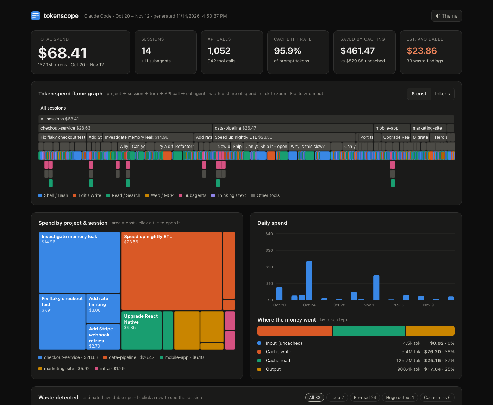

<div align="center">

# tokenscope

**Find out where your AI coding agent spent your money. A flame graph for tokens.**

`npx tokenscope`

Zero dependencies · runs 100% locally · Claude Code + Codex CLI · MIT



<sub>Screenshot generated from synthetic logs (`npm run demo`). Open <a href="docs/demo-report.html">docs/demo-report.html</a> for the interactive version.</sub>

</div>

---

Your agent bill says **$1,600**. Which session caused it? Which turn? Was it the 6,000 `Bash` calls, a 60k-token log dump,
or the 40-minute lunch break that made the prompt cache expire and re-wrote 2M tokens at full price?

`tokenscope` reads the session logs your agent already keeps on disk, prices every API request (cache reads and writes
included), and shows you where the money went, down to the individual tool call.

## Install

```bash
npx tokenscope              # terminal summary
npx tokenscope --html --open # interactive report with flame graph
```

Needs Node 20+. Nothing to configure, no API keys, no network calls. Your logs never leave your machine.

## What you get

- **Real cost per session, project, model and day.** Every request is priced from a single
  [pricing table](src/pricing/pricing.json), including 5-minute and 1-hour cache writes, cache reads,
  long-context tiers and fast mode. On Claude Code logs the per-request math matches Claude Code's own cost counter.
- **A flame graph of spend:** project → session → turn → API call → subagent → its calls. Click to zoom; switch between $ and tokens.
- **Subagents are attributed to the call that spawned them**, so a `Task`/`Agent` call that cost $25 shows up as $25, not as a one-line tool call.
- **Waste detection**, each with an estimated dollar cost:
  - **Cache rebuilds:** the context was re-sent at cache-*write* price. Tells you why: an idle gap longer than the TTL, a model switch, or a changed prefix.
  - **Loops:** the same tool called with the same input and the same result, again and again.
  - **Unchanged re-reads:** the same file (same range) read again with no edit in between.
  - **Huge tool outputs:** `cat`-ing a 60k-token log into context, and paying to carry it on every later request.
  - **Repeats:** identical call, identical answer, scattered through a session.
- **Three outputs:** a terminal summary (default), `--json` for scripts and dashboards, and `--html` for a single
  self-contained file you can open, share or screenshot.
- **`--redact`** replaces prompts, titles, file paths and commands with placeholders, so you can share a report safely.
- **Fast:** about 300 MB of transcripts (7.8k API calls) in about 1 second.

## Usage

```text
tokenscope [options]

Output
  (default)              pretty terminal summary
  --html [file]          self-contained HTML report (default: tokenscope-report.html)
  --json [file]          machine-readable report (stdout when no file given)
  --open                 open the HTML report when done

Filters
  --since <when>         7d, 24h, 2w, or a date (2026-11-01)
  --until <when>         same formats
  -p, --project <text>   only projects whose name/path contains <text>
  --source <id>          claude-code | codex | all

Sources
  --dir <path>           Claude Code projects dir (default ~/.claude/projects, honors CLAUDE_CONFIG_DIR)
  --codex-dir <path>     Codex sessions dir (default ~/.codex/sessions, honors CODEX_HOME)

Tuning
  --pricing <file>       JSON overrides merged over the built-in pricing table
  --huge <tokens>        tool output size flagged as huge (default 10000)
  --top <n>              rows per terminal section (default 8)
  --redact               hide prompts, titles, paths and commands
  --no-color             disable ANSI colors (also honors NO_COLOR)
```

Examples:

```bash
npx tokenscope --since 7d                      # last week
npx tokenscope -p checkout --html report.html  # one project, as HTML
npx tokenscope --json | jq '.totals.cost'      # pipe the number into anything
npx tokenscope --redact --html share.html      # safe to post in Slack
```

## Supported agents

| Agent | Logs | Status |
|---|---|---|
| Claude Code | `~/.claude/projects/<project>/<session>.jsonl` + `…/subagents/agent-*.jsonl` | ✅ Full support, including subagents, resumed/forked session de-duplication, and 5m/1h cache-write split |
| Codex CLI | `~/.codex/sessions/YYYY/MM/DD/rollout-*.jsonl` | 🧪 Experimental: built from the documented rollout format and tested on synthetic fixtures, not yet on a large set of real logs |
| Cursor, Aider, Gemini CLI, Cline… | | Planned. Parsers are pluggable; see [CONTRIBUTING.md](CONTRIBUTING.md) |

## Why tokenscope?

| | Provider billing page | `/cost` in the agent | Usage dashboards / daily totals | **tokenscope** |
|---|---|---|---|---|
| Total spend | ✅ | ✅ (current session) | ✅ | ✅ |
| Per session / per project | ❌ | ❌ | partial | ✅ |
| Per turn and per tool call | ❌ | ❌ | ❌ | ✅ flame graph |
| Subagent cost attributed to its parent call | ❌ | ❌ | ❌ | ✅ |
| Cache-miss diagnosis (why it missed) | ❌ | ❌ | ❌ | ✅ |
| Loops, re-reads, giant outputs | ❌ | ❌ | ❌ | ✅ with $ estimates |
| Works offline, no account | ❌ | ✅ | varies | ✅ |

Knowing the total is easy. Knowing *what to change* is what saves money. tokenscope is a profiler, not a meter.

## How costs are computed

For each API request: `input × in + output × out + cache_read × read + cache_write_5m × 1.25·in + cache_write_1h × 2·in`,
using the rates in [`src/pricing/pricing.json`](src/pricing/pricing.json). Model ids are normalized (Bedrock/Vertex prefixes,
`-v1:0`, date suffixes and `[1m]` are stripped) and matched exactly or by longest prefix. Models that aren't in the table are
counted as $0 and listed in a warning, never guessed.

Prices change. To update them, edit `pricing.json` (PRs welcome) or pass your own file:

```bash
npx tokenscope --pricing my-prices.json   # { "models": { "my-model": { "input": 1, "output": 5 } } }
```

Waste numbers are **estimates**: avoidable tokens × the cost of writing them to the cache once, plus the cache reads every
later request in that context paid to carry them. They tell you where to look first. They are not refunds.

## Privacy

tokenscope only reads files on your machine and writes the report you ask for. It makes no network requests and sends no
telemetry. HTML reports include prompt snippets and file paths unless you pass `--redact`. The test suite uses
synthetic fixtures only.

## Roadmap

- [ ] Cursor, Aider, Gemini CLI and Cline parsers
- [ ] Validate the Codex parser against more real-world rollouts
- [ ] `tokenscope watch`: live cost of the current session in your status line
- [ ] Budgets and CI mode (`--fail-over $20`) for headless agent runs
- [ ] Diff two time ranges ("what got more expensive this week?")
- [ ] More detectors: context bloat before compaction, unused tool definitions, over-thinking on trivial turns
- [ ] Automatic pricing updates from a published feed (opt-in)
- [ ] Per-git-branch and per-PR cost

## Development

```bash
npm install
npm test          # vitest, synthetic fixtures
npm run build     # tsc -> dist/
npm run smoke     # run the CLI against the fixtures
npm run demo      # generate synthetic logs + docs/demo-report.html
```

See [CONTRIBUTING.md](CONTRIBUTING.md). **Never commit real session logs.** They contain your prompts, code and secrets.

## License

MIT
